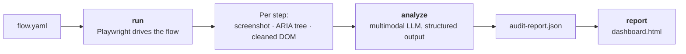
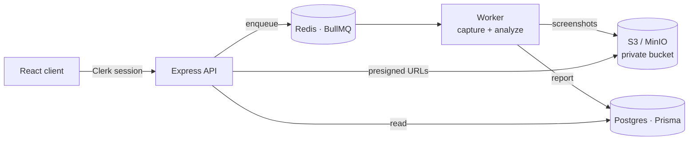

<h1 align="center">ux-audit</h1>

<p align="center">
  Drive a real browser through a user flow, capture what the page looks like after every step, and have a multimodal LLM audit it against <b>Nielsen's 10 heuristics</b> and <b>WCAG 2.1</b>, with severity, element selector and a suggested code fix for each issue.
</p>

<p align="center">
  <a href="https://github.com/P4d1lh4/Nielsen-analytics/actions/workflows/ci.yml"></a>
</p>

<p align="center">
  
  
  
  
  
  
  
  
  
</p>

<p align="center">
  <a href="#overview">Overview</a> ·
  <a href="#quick-start">Quick start</a> ·
  <a href="#flow-config">Flow config</a> ·
  <a href="#cli">CLI</a> ·
  <a href="#service-async-api--worker">Service</a> ·
  <a href="#web-client">Web client</a> ·
  <a href="#tests--ci">Tests</a> ·
  <a href="#project-layout">Layout</a>
</p>

## Overview

The same pipeline runs in two ways: as a **CLI** on your machine, or as a **service** with an HTTP API, a job queue, a worker and a React client.



| Phase | Command | What it does |
|---|---|---|
| 1 | `run` | Drives a headless browser through a scripted flow and captures the full state of the page after every step. No AI involved. |
| 2 | `analyze` | Sends each step's artifacts to a multimodal LLM and produces a structured Nielsen + WCAG 2.1 audit report. |
| 3 | `report` | Turns the audit JSON into a single-file interactive HTML dashboard. |
| 1 → 3 | `pipeline` | Runs the three phases in order, unattended, and stops at the first failure. |

Each finding in the report looks like this:

```json
{
  "heuristic": "Error prevention",
  "severity": 3,
  "issue_description": "Text input has no associated <label> (WCAG 2.1 SC 1.3.1).",
  "element_selector": "#name",
  "suggested_code_fix": "<label for=\"name\">Name</label><input id=\"name\">"
}
```

## Quick start

Requires Node.js 18 or later.

```bash
# 1. Install dependencies (postinstall downloads the Chromium binary)
npm install

# If the browser was not fetched automatically:
npx playwright install chromium

# 2. Compile TypeScript -> dist/
npm run build

# 3. Run the whole pipeline on the sample flow
node dist/index.js pipeline --config examples/my-flow.yaml
```

The default engine uses your logged-in Claude Code, so no API key is needed. See [Two engines](#two-engines---engine) for the pay-per-token alternative.

Other ways to invoke the CLI:

```bash
# After `npm link`, or when installed:
ux-audit run --config examples/my-flow.yaml

# Via npx (published/linked):
npx ux-audit run --config examples/my-flow.yaml

# Dev mode, no build step (tsx):
npm run dev -- run --config examples/my-flow.yaml
```

## Flow config

A flow is a YAML file, validated strictly with Zod before anything runs. See [`examples/my-flow.yaml`](examples/my-flow.yaml) for a complete login-and-add-to-cart flow.

```yaml
target_url: "https://example.com"   # initial navigation + folder slug
viewport: { width: 1366, height: 768 }
flow:
  - { action: goto,  url: "https://example.com/login" }
  - { action: type,  selector: "#user", text: "alice" }
  - { action: click, selector: "#submit" }
  - { action: wait,  ms: 1000 }
  - { action: scroll }
```

| Action | Fields | Effect |
|---|---|---|
| `goto` | `url` | Navigates to an absolute URL. |
| `click` | `selector` | Clicks the element. |
| `type` | `selector`, `text` | Types the text into the element. |
| `wait` | `ms` | Waits a fixed number of milliseconds. |
| `scroll` | none | Scrolls down by one viewport height. |

## CLI

### Phase 1: `run` (capture)

```bash
node dist/index.js run --config examples/my-flow.yaml
#   --out <dir>   root output directory (default: .ux-audit-reports)
```

After every step, three artifacts are captured:

| Artifact | File | Source |
|---|---|---|
| Screenshot of the viewport | `*.png` | Playwright |
| Accessibility tree | `*.a11y.yaml` | Playwright native `ariaSnapshot` (YAML) |
| Cleaned DOM | `*.dom.html` | Full HTML with `<script>`, `<style>`, `<link>` and comments removed |

All artifacts land in `./.ux-audit-reports/<timestamp>_<target>/`, alongside a `session-manifest.json` (a JSON array of every successfully executed step with relative paths to its three artifacts).

**Resilience**

- Selector actions (`click`, `type`) have a **5s** timeout; navigation has 30s.
- If a step fails (selector not found / timeout), the run **stops gracefully**, the manifest is written for all steps completed so far, a clear error is printed, and the process exits with **code 1**.

### Phase 2: `analyze` (LLM audit)

```bash
node dist/index.js analyze --report-dir ./.ux-audit-reports/<...>
#   --engine <engine>  agent-sdk (default, Claude plan) | api (AI_API_KEY)
#   --model <id>       default: claude-sonnet-4-6
```

Reads a session's `session-manifest.json`, and for **each step** sends the screenshot (base64), the cleaned DOM, and the ARIA tree to a multimodal LLM, forcing a structured audit response.

- **Model:** `claude-sonnet-4-6` by default, with adaptive thinking (`effort: high`). Override per run with `--model <id>` (e.g. `--model claude-opus-4-8`).
- **Structured output:** the response is forced to a JSON schema via `messages.parse()` + `zodOutputFormat` ([auditSchema.ts](src/evaluator/auditSchema.ts)) and validated client-side.
- **Scope:** the system prompt restricts findings to **Nielsen's 10 heuristics** and **WCAG 2.1**, and explicitly ignores visual aesthetics.
- **Prompt caching:** the frozen system prompt carries a cache breakpoint, so it is reused across every step of a session.

#### Two engines (`--engine`)

| `--engine` | How it calls Claude | Cost |
|---|---|---|
| `agent-sdk` (default) | `@anthropic-ai/claude-agent-sdk` → your logged-in Claude Code | **No money**: uses your Claude plan |
| `api` | `@anthropic-ai/sdk` → Anthropic API | **Pay-per-token** (needs `AI_API_KEY`) |

```bash
# Default: uses your Claude plan (agent-sdk + Sonnet 4.6). No API key, no $.
# Requires being logged into Claude Code; do NOT set ANTHROPIC_API_KEY.
node dist/index.js analyze --report-dir ./.ux-audit-reports/<...>

# Deeper audit on the plan (Opus, more nuanced; costs more of the weekly quota):
node dist/index.js analyze --report-dir ./.ux-audit-reports/<...> --model claude-opus-4-8

# Pay-per-token via the API instead (does not touch your plan quota):
export AI_API_KEY="sk-ant-..."        # PowerShell: $env:AI_API_KEY="sk-ant-..."
node dist/index.js analyze --report-dir ./.ux-audit-reports/<...> --engine api
```

<details>
<summary><b>Which quota does <code>agent-sdk</code> use?</b></summary>

<br/>

It spawns your logged-in Claude Code, so usage is billed to your **Claude plan, not pay-per-token**. Important nuance on *which* plan bucket:

- **Until 2026-06-14:** Agent SDK usage shares the **same Session (5h) + Weekly (7-day)** limits as interactive Claude Code, i.e. it *does* consume the percentages in your Account & Usage panel.
- **From 2026-06-15:** it moves to a **separate monthly Agent SDK credit** (Max5x ≈ $100 / Max20x ≈ $200) and stops counting against Session/Weekly.
- **Sonnet 4.6** (the default model) draws from the separate **"Weekly Sonnet"** allowance, sparing the general weekly limit. Opus counts against the general "Weekly (7-day)" bucket.

More detail in [`docs/billing-agent-sdk.md`](docs/billing-agent-sdk.md).

</details>

#### Output

`audit-report.json` is written to the same report directory. Per analyzed step it holds the strict format:

```json
{
  "step_name": "step_03_click",
  "violations": [
    {
      "heuristic": "Error prevention",
      "severity": 3,
      "issue_description": "Text input has no associated <label> (WCAG 2.1 SC 1.3.1).",
      "element_selector": "#name",
      "suggested_code_fix": "<label for=\"name\">Name</label><input id=\"name\">"
    }
  ]
}
```

`severity` is the Nielsen 1–4 scale (1 cosmetic … 4 catastrophe); `element_selector` is `null` when the issue is page-wide.

**Resilience**

- Per-step LLM failures (API error, refusal, no structured output) are caught and recorded; analysis **continues** with the remaining steps.
- The report is always written. If any step failed, the process exits with **code 1**; otherwise **0**.

### Phase 3: `report` (HTML dashboard)

```bash
node dist/index.js report --report-dir ./.ux-audit-reports/<...>
```

Writes `dashboard.html` into the report directory. Open it in a browser.

- **Self-contained:** the data is **baked in** to a `<script>const auditData = …</script>`, so there is **no `fetch`/XHR**. Screenshots load via **relative** `` from the same folder. (Tailwind CSS is loaded via CDN per spec, so styling needs internet.)
- **Data source:** it merges `session-manifest.json` (screenshot paths) with the audit report, read **strictly** from `audit-report.json` (no fallbacks). If that file is missing, the command errors clearly and exits **1**.
- **UI:** header with counters (steps / analyzed / violations) and per-severity chips; a sidebar of `step_name`s (badge = worst severity); a main pane with the resized screenshot and one card per violation (heuristic, color-coded severity badge, with **Crítico = red**, description, selector, and a `<pre><code>` `suggested_code_fix`).
- **Security:** every `<` in the embedded data is escaped to its `\u003c` unicode form, so a `</script>` inside any audit text can't break out of the data block; the client builds the DOM with `textContent` (no `innerHTML` injection).

### `pipeline`: all three phases, unattended

```bash
node dist/index.js pipeline --config examples/my-flow.yaml
#   --out <dir>        root output directory (default: .ux-audit-reports)
#   --engine <engine>  agent-sdk (default, Claude plan) | api (AI_API_KEY)
#   --model <id>       default: claude-sonnet-4-6
```

It runs **Phase 1 → Phase 2 → Phase 3** in order against one freshly-created report directory. **Fail-fast:** if Playwright fails in capture, or any step errors/times out in analysis, the pipeline **aborts immediately with exit 1** and does not run the next phase on broken data (the partial manifest/report are left behind for inspection).

## Service (async API + worker)

Besides the CLI, the repo ships a **SaaS service**: an HTTP API enqueues audit jobs onto a **BullMQ/Redis** queue; a **worker** runs the same capture+analyze pipeline, uploads screenshots to **S3/MinIO** (private bucket, served via short-lived presigned URLs) and persists the report to **Postgres via Prisma**. Auth is **Clerk**; the Clerk webhook is verified with **svix**.



### Endpoints

| Method | Path | Auth | What it does |
|---|---|---|---|
| `POST` | `/api/audit` | Clerk | Enqueues a job and returns `202 { job_id, status }` without waiting for it to finish. |
| `GET` | `/api/audit` | Clerk | Lists the caller's audit history. |
| `GET` | `/api/audit/:id` | Clerk | Job status or report, with presigned screenshot URLs. |
| `POST` | `/api/webhook/clerk` | svix signature | Clerk webhook; purges a user's reports and artifacts on `user.deleted`. |
| `GET` | `/health` | public | Readiness: `200` when Postgres is reachable, `503` otherwise. Redis state is reported but is not fatal. |

### Hardening

- **SSRF guard:** audit targets that resolve to loopback, private, link-local (including cloud metadata) or other non-public addresses are blocked before navigation ([urlGuard.ts](src/engine/urlGuard.ts)).
- **Rate limiting:** `POST /api/audit` is limited per authenticated user, 10 requests per 5 minutes by default (`AUDIT_RATE_LIMIT`).
- **Retries:** failed jobs are retried up to 3 times with exponential backoff.
- **Private storage:** the bucket is private; screenshots are only reachable through short-lived presigned URLs.
- **HTTP headers and CORS:** `helmet` is on, and cross-origin access is denied unless `CORS_ORIGIN` lists the origin.
- **Environment validation:** required variables are checked at boot, and the process fails fast when one is missing.

Each of these changes is written up in [`docs/alteracoes/`](docs/alteracoes/INDEX.md) (in Portuguese), with the backlog it came from in [`docs/auditoria/`](docs/auditoria/01-backlog.md).

### Run it

```bash
cp .env.example .env          # fill in DATABASE_URL, CLERK_*, S3_*, etc.
docker compose up             # postgres + redis + minio + api + worker
# or locally, against your own infra:
npm run serve                 # API    (tsx src/service/server.ts)
npm run worker                # worker (tsx src/service/worker.ts)
```

### Environment

Validated at boot (fail-fast). See [`.env.example`](.env.example) for the full list.

| Var | Used by | Notes |
|---|---|---|
| `DATABASE_URL` | api, worker | Postgres (Prisma) |
| `REDIS_URL` | api, worker | optional; defaults to `redis://127.0.0.1:6379` |
| `CLERK_SECRET_KEY` | api | required for auth |
| `CLERK_WEBHOOK_SECRET` | api | required only to use the webhook |
| `S3_ENDPOINT` / `S3_BUCKET_NAME` / `S3_ACCESS_KEY` / `S3_SECRET_KEY` | worker | private bucket |
| `S3_PUBLIC_ENDPOINT` | api | host-reachable endpoint for signing screenshot URLs (MinIO split-horizon) |
| `AUDIT_ENGINE` / `AUDIT_MODEL` / `AI_API_KEY` | worker | `api` engine needs `AI_API_KEY` |
| `AUDIT_RATE_LIMIT` | api | max `POST /api/audit` requests per user per 5 minutes; defaults to `10` |
| `WORKER_CONCURRENCY` | worker | jobs processed in parallel; defaults to `2` |
| `PORT` | api | HTTP port |
| `CORS_ORIGIN` | api | comma-separated allowlist; unset = no cross-origin |
| `LOG_JSON` | all | `1` forces JSON logs (auto-on when `NODE_ENV=production`) |

## Web client

A React + Vite app in [`client/`](client/) that submits audits, polls the job and shows the report. It signs in with Clerk and attaches the session token to every API call.

```bash
cd client
cp .env.example .env          # set VITE_CLERK_PUBLISHABLE_KEY
npm install
npm run dev
```

In dev mode, Vite proxies `/api/*` to the backend at `http://localhost:3000`, so start the API first.

## Tests & CI

```bash
npm run typecheck    # tsc --noEmit
npm test             # node:test via tsx (src/**/*.test.ts)
npm run build        # tsc -> dist/
```

CI ([`.github/workflows/ci.yml`](.github/workflows/ci.yml)) runs on every push and pull request: typecheck → test → build for the backend, and a build for the client.

## Project layout

```
src/
  index.ts            # bin entrypoint (#!/usr/bin/env node)
  cli.ts              # commander program: run, analyze, report, pipeline
  logger.ts           # structured logger (ANSI or JSON)
  config/
    schema.ts         # Zod schema (discriminated-union flow)
    loader.ts         # YAML read + strict validation
    env.ts            # environment validation
  engine/
    browser.ts        # AuditEngine: Playwright orchestration loop
    actions.ts        # goto / click / type / wait / scroll executors
    urlGuard.ts       # SSRF guard for audit targets
  capture/
    artifacts.ts      # screenshot + a11y + DOM capture
    domCleaner.ts     # in-page DOM cleaning (runs in Chromium)
  output/
    paths.ts          # timestamped output dir + target slug
    manifest.ts       # session-manifest.json writer
  evaluator/          # Phase 2: LLM analysis
    manifest.ts       # read + validate a Phase 1 manifest (Zod)
    client.ts         # Anthropic API client (reads AI_API_KEY)
    payload.ts        # per-step multimodal content (image + DOM + ARIA)
    auditSchema.ts    # Zod schema for the forced structured output
    prompt.ts         # frozen auditor system prompt (Nielsen + WCAG)
    evaluator.ts      # Evaluator (api engine) + shared runAnalysis loop
    agentEngine.ts    # AgentSdkEvaluator (agent-sdk engine, uses your plan)
    report.ts         # audit-report.json writer + console summary
  dashboard/
    generator.ts      # Phase 3: single-file HTML dashboard
  service/            # async API + worker
    server.ts         # Express API
    worker.ts         # BullMQ worker
    queue.ts          # queue definition (retries, backoff)
    connection.ts     # Redis connection
    storage.ts        # S3/MinIO uploads + presigned URLs
    schema.ts         # request validation
client/               # React + Vite web client
prisma/               # schema + migrations
docs/                 # audit backlog and change notes (Portuguese)
examples/
  my-flow.yaml        # sample flow
```
